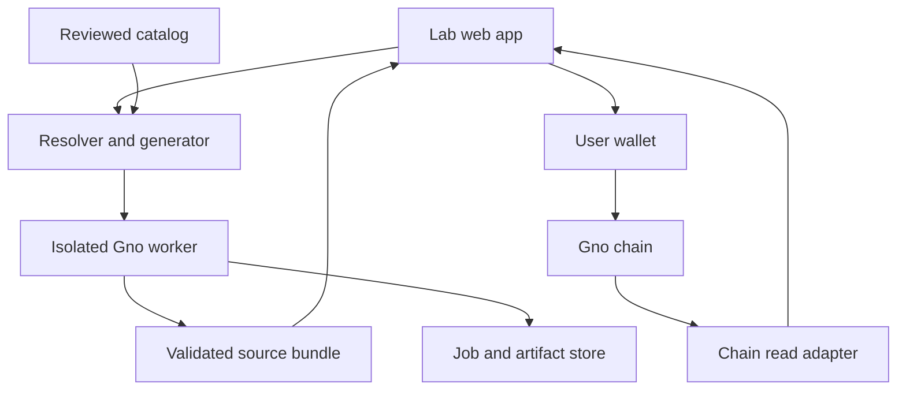

**Remix Lab implementation plan**

Prepared 7 October 2026. This document proposes the product, implementation sequence, technical contracts, and acceptance criteria. Package names, schemas, APIs, limits, and estimates below are Remix Lab design proposals unless identified as documented Gno capabilities.

**1. Product goal and working assumptions**

Remix Lab lets someone assemble a useful Gno application from reviewed components, understand the generated code, test it, and deploy a realm they control. The product should make code reuse visible: every app shows its ingredients, every component links to its source, and every successful recipe can be remixed.

The first audience is developers learning Gno and technically curious community organizers. Reading, configuring, and previewing a recipe should work without a wallet. A wallet becomes necessary when deploying or writing to a public chain.

Assume a new project, two full-time engineers with Gno experience between them, part-time product/design support, and an independent Gno reviewer for release. Use a 12-week planning baseline, subject to a compatibility spike in week 1. A solo implementation would likely take roughly five to seven months at this scope; that is a planning estimate, not a delivery commitment.

Recommended first release:
- Five user-facing blocks: membership, permission policies, forms, public ballots, and rendering.
- Three recipes: club poll, community directory, and demo contest.
- A shared contracts package supporting those blocks.
- One verified public testnet profile, plus a matching local development environment.
- A curated catalog, deterministic generation, scenario previews, downloadable projects, browser-wallet deployment, and a CLI deployment route.
- One shared-service integration: connect a poll to an existing, reviewed membership realm.

General-purpose code editing, arbitrary realm compatibility, automatic production upgrades, fund-handling components, private submissions, and a public component marketplace belong to later releases. The architecture below leaves room for them.

The product promise is: choose a recipe, change its rules, inspect the resulting Gno, validate it, deploy it, and use the same realm through both its native render and the Lab's application view.

**2. Gno capabilities and implementation consequences**

Gno documentation evolves independently of each deployed network. Record the toolchain release, chain profile, dependency paths, source digests, and observed capabilities for every release. Verify all required operations against the target chain before promising support.

| Documented capability | Implementation consequence |
|---|---|
| Pure packages live under /p/ and do not own persistent application state; realms under /r/ persist state. | Offer reusable libraries instantiated by an app realm, and separately offer adapters to existing shared realms. [S1] |
| /p/ packages cannot import /r/ packages. | Put shared interfaces and inert view types in /p/; put imports of concrete shared services and their adapters in generated /r/ code. [S1, S2] |
| Realm calls have explicit authority and storage semantics. The v2 specification describes current HEAD. | Prove the generated entry-point pattern, library encapsulation, and interrealm adapters using the target network's release. [S3] |
| Structured query endpoints return Amino JSON, including typed values and object references. | Implement a bounded decoder and stable application read APIs. Do not treat every RPC result as plain application JSON. [S4] |
| The current RPC reference has no subscribe, tx_search, or block_search endpoints. | Poll known transaction hashes and application reads. Add an external indexer when discovery/history requires one. [S5] |
| A mempool acceptance response is different from successful execution in a block. | Deployment and actions remain pending until execution is confirmed; inspect application-level errors as well as transport errors. [S5] |
| GnoConnect documents transaction links; its Run Calls section is unfinished. | Use transaction links for supported calls. Implement add-package deployment through a tested wallet adapter, with CLI export as a second route. [S6, S7] |
| gnomod.toml supplies package metadata; local replacement directives are unsuitable for on-chain deployment. | Generate valid target metadata, resolve published dependencies explicitly, and keep local development overrides out of deployable bundles. [S8] |
| gno test uses a mocked VM and local imports. | Pair unit tests with actual local-node and public-testnet deployment tests so local examples do not hide missing chain dependencies. [S9] |
| Storage deposits and gas affect writes and package deployment. | Estimate and display them separately, support applicable limits, and recheck the current network's parameters. [S10, S11] |

As of this document, the official network reference lists Pearl/Test16 with chain ID pearl-1, Staging with staging, and Mainnet with gnoland-1. It describes Staging persistence as best effort. Use the verified testnet for the public beta and Staging for forward-compatibility experiments. Keep the network list configurable. [S12]

Some guides and older SDK examples disagree about current chain names, language syntax, or message fields. The week-one spike should produce working fixtures and a compatibility report; those fixtures become the implementation reference.

**3. User journeys and product screens**

The main builder journey has seven stages.

| Stage | User action | Product result |
|---|---|---|
| Discover | Browse recipes and components; try an existing demo. | A useful app and its ingredients are understandable before configuration. |
| Configure | Choose a recipe and change membership, permissions, form fields, or ballot rules. | A validated project specification saved locally. |
| Compose | Select an owned component instance or a compatible shared membership service. | Explicit bindings with readable compatibility errors. |
| Preview | Run prepared scenarios using the generated configuration. | Gno-backed outputs labeled with the scenario, toolchain, and environment. |
| Inspect | Read source, imports, generated tests, and permission summaries. | A reviewable project with clear attribution and dependencies. |
| Validate and deploy | Connect a wallet, resolve the final realm path, run checks, review costs, and sign. | A tracked deployment and verified runtime source bundle. |
| Use and remix | Open the app, share its realm URL, or copy its recipe configuration. | Real interactions and a reusable starting point for another app. |

Implement these screens:
- Catalog: search by capability, component type, supported network, and review status.
- Component detail: purpose, supported interfaces, configuration, source, dependencies, sample app, tests, review scope, and versions.
- Recipe detail: live demo, ingredients, example rules, and a Configure action.
- Composer: a readable component list, configuration panel, and dependency/binding view. A complex drag-and-drop canvas can follow later.
- Preview and validation: scenario controls, rendered output, permission results, test results, and source changes.
- Deployment review: exact network, signer, package path, source digest, imported paths, fee/deposit information, and expected transactions.
- App inspector: composition, native realm link, source link, confirmed deployment receipt, supported actions, and remix/export actions.

A person should be able to complete the default club-poll configuration without editing code. A developer should be able to export the same project, reproduce its tests, and inspect its deployment payload.

Keep configuration changes explicit. Changing a poll from open eligibility to membership eligibility should update the permission summary and generated code. Show differences from the last validated configuration. Advanced diagnostics can live in expandable details.

**4. Architecture and technology choices**

Recommended stack:
- React and TypeScript for the web application, with a conventional bundler such as Vite.
- A shared TypeScript package for schemas, catalog resolution, configuration validation, intermediate representation, and deterministic generation.
- Gno packages for reusable logic and example realms.
- A small Go validation service/worker, wrapping a pinned Gno toolchain and using the official Go client where appropriate.
- A narrow TypeScript chain adapter around a verified JS client or direct JSON-RPC transport; isolate Amino decoding from UI code.
- An Adena adapter initially, with a wallet interface that supports additional providers later.
- A curated catalog stored in version control.
- A small durable SQL job store and object storage for validation artifacts. SQLite is sufficient for a single-worker private alpha; use Postgres when replicas or multiple workers are introduced.

Pin all tool and library versions after the compatibility spike. These are recommended project choices, not requirements imposed by Gno.



The wallet owns signing. Validation workers never need a user's mnemonic or signing key. Public-chain writes originate from user-approved wallet transactions or the user's own CLI.

The chain owns application state. The catalog owns reviewed component metadata. The job store owns operational records and reproducible reports. A hosted app view can be rebuilt from its deployment record and realm reads.

Treat RPC-derived source and state as observations from the configured node. Comparing a source digest with an RPC response establishes agreement with that node; it is not a cryptographic light-client proof. The current module query documentation does not promise proofs for ordinary vm queries. [S5]

**5. Repository structure and deliverables**

Use a monorepo initially so schemas, generator changes, Gno packages, and recipes are reviewed together.

| Location | Responsibility |
|---|---|
| apps/web/ | Catalog, composer, previews, deployment review, app inspector |
| services/validator/ | Job API, scheduling, isolated toolchain execution |
| packages/spec/ | Project schema, component schema, catalog/lockfile types |
| packages/resolver/ | Dependency resolution, bindings, network capability checks |
| packages/generator/ | Intermediate representation, source templates, formatting integration |
| packages/chain/ | RPC transport, Amino normalization, reads, transaction tracking |
| packages/wallet/ | Provider discovery, account/network events, signing adapters |
| catalog/components/ | Reviewed release manifests and dependency metadata |
| catalog/recipes/ | Valid recipe graphs, defaults, scenarios, and expected actions |
| gno/p/ | Reusable Gno packages and their tests |
| gno/r/ | Reference realms, shared membership service, generated fixtures |
| tests/integration/ | Local-node and public-testnet smoke scenarios |
| docs/ | Component authoring, release process, architecture decisions |

Each app export should contain runtime .gno files, gnomod.toml, tests, project configuration, a resolved dependency lockfile, provenance/notices, validation report, and deployment instructions. Add local workspace metadata only where the pinned tooling requires it. Create the on-chain payload from runtime files and accepted metadata; confirm accepted file types in the spike.

Do not bundle every dependency into a realm as copied source. Publish reviewed reusable /p/ releases separately and import their exact paths. Keep a reproducible dependency snapshot in release artifacts for testing and provenance.

**6. Component and recipe contracts**

Create a Remix Lab component manifest format. This is project metadata, not a Gno platform standard.

Each manifest describes:
- A stable component ID, catalog release version, and schema version.
- Whether it is a library block or an adapter to a shared service.
- Exact published package paths by supported network.
- Runtime source digests, maintainer identity, license identifier, attribution URL, and upstream sources.
- Interfaces provided and required, each with an explicit version.
- Configuration schema, defaults, and hard bounds.
- State ownership, authority requirements, and exposed read/write capabilities.
- Named operations, argument schemas, view schemas, error categories, and render routes.
- Dependencies, approved bindings, conflicting settings, and required network capabilities.
- Test/scenario suite, last review scope, release commit, and measured gas/storage baselines.
- Lifecycle states such as draft, reviewed, published, deprecated, and withdrawn from new compositions.

A conceptual membership manifest fragment:

```json
{
  "schemaVersion": 1,
  "id": "membership",
  "catalogVersion": "1.0.0",
  "kind": "library",
  "provides": ["membership.read/v1", "membership.admin/v1"],
  "requires": ["authority.context/v1"],
  "config": {
    "joinMode": "invitation",
    "maxMembers": 100
  },
  "stateOwner": "host-realm",
  "reviewStatus": "draft"
}
```

A production manifest additionally requires resolved network paths, source digests, dependency pins, and review evidence. An unresolved or draft release cannot produce a publicly supported deployment.

Keep interfaces small:
- MembershipReader: membership/role lookup and a bounded eligibility snapshot.
- AuthorizationPolicy: an allowed/denied decision for a named operation and authenticated actor.
- SubmissionReader: paginated summaries of submitted records.
- BallotReader: poll status and a normalized tally.
- ViewProvider: bounded view records for a known page/action set.

Define inert shared data types and reusable interfaces in /p/. Avoid exposing mutable internal objects through those types. Concrete imports and service bindings belong in the host realm. Gno's guidance supports separating reusable definitions from realm implementations. [S2]

A recipe is a tested graph plus an application controller template. It declares required components, legal configurations, bindings, pages, public entry points, fixtures, and invariants. Components sharing an interface name are accepted only after their adapter and recipe combination pass conformance tests.

Start with explicit, curated bindings. For example, a ballot can depend on either the app's own membership instance or a known shared membership reader. A manifest alone does not establish trust or safe interoperability.

**7. Initial Gno packages and reference APIs**

Use paths under the maintainer's actual authorized namespace, for example gno.land/p/<maintainer-address>/remix/membership/v1. The address and published paths are resolved during setup. Examples here are placeholders.

| Package | Proposed responsibility | Critical behavior |
|---|---|---|
| core | Inert view records, identifiers, interface definitions, error categories | No pointers to authoritative mutable internals; versioned public shapes |
| membership | Member sets, roles, join/invitation rules, bounded listing | Realm wrapper authenticates mutations; eligibility is explicit |
| policies | Named operation rules using addresses, membership, and roles | Admin powers remain separate from ordinary membership |
| forms | Field schemas, typed answers, submission IDs, statuses | Validate in Gno as well as the browser; freeze a schema once used |
| ballots | Public single-choice polls, eligibility snapshot, deadlines, quorum, tally | One eligible address per ballot; fixed options; explicit ties and abstention rules |
| render | Escaped text, navigation, paginated lists/tables, supported transaction links | Untrusted text cannot inject actions or active markup |

Use existing dependencies when their behavior and deployed versions fit. Evaluate ownership/authorization helpers, address sets, ordered indexes, sequential IDs, and Markdown helpers. The community catalog is a discovery source, not a guarantee of maintenance or importability; it explicitly marks some examples as quarantined. [S13]

For stateful library blocks, construct and retain their objects inside a host realm. Keep sensitive backing storage unexported. Public getters return inert summaries, scalar values, or carefully constructed read views. Realm entry points perform authentication before calling internal logic.

Proposed MVP semantics:
- Membership: invitation or open joining; owner/reviewer/member roles; leave and remove; a bounded membership list.
- Policies: public, member, reviewer, or owner eligibility per named operation. Changes affect future operations; ballot eligibility follows its frozen snapshot.
- Forms: text, integer, and choice fields; required fields; bounded submissions; submitted/accepted/rejected status. Schema changes require a new form once submissions exist.
- Ballots: single-choice public voting, immutable options after opening, bounded electorate captured at opening, one vote per eligible address, quorum based on the captured electorate, and a deterministic no-winner result for ties. The owner opens a poll; anyone may finalize it after the deadline using the already-fixed rules. Early closure is disabled in the initial recipe. Use integer thresholds and explicit rounding rules.
- Rendering: native realm pages for overview, entries, polls, and results; source links and supported transaction links.

Starting measurement limits: 100 members, 100 submissions, 10 fields per form, 20 ballot options, and 25 records per list page. Also cap UTF-8 byte lengths for every text field and the total answer payload. Tune these limits after gas/storage measurements; the number of records alone is not a sufficient bound.

A deadline is evaluated when a transaction or read occurs. The chain does not execute an app's closing function merely because wall-clock time passes. A poll can display that its deadline passed, while a permitted finalization call commits its final result. Future scheduling requires an explicit keeper or external caller.

Membership is address-based. The UI must not imply that one address equals one human.

**8. Three launch recipes**

| Recipe | Composition | Main rules | Acceptance scenario |
|---|---|---|---|
| Club poll | Membership + policies + ballots + render | Members vote; owner opens/closes; electorate freezes at opening | Add two members, open a poll, cast votes, reject a nonmember, inspect the tally |
| Community directory | Forms + policies + render, with optional membership | Users submit entries; reviewers accept/reject; accepted entries appear publicly | Submit a project, reject invalid fields, approve it, paginate entries |
| Demo contest | Forms + membership + policies + ballots + render | Entrants submit; reviewers admit up to the configured ballot limit; eligible voters choose a winner | Admit entries, freeze choices/electorate, vote, finalize and display winner or tie |

The directory and contest controllers implement a small fixed review lifecycle. A general workflow engine is a later component extracted after both controllers expose reusable requirements.

Provide an additional composition demo: a club poll whose eligibility is supplied by an existing shared membership realm. In v1, use that service for read-only membership checks and snapshot creation. Users manage membership through that realm's own authorized interface. Shared mutations and delegation require a separate reviewed protocol.

This demonstrates both forms of reuse: separate app realms instantiate the same library logic, and another app consults a common membership realm.

**9. Deterministic generation pipeline**

The generator transforms a project specification into readable source. It does not translate arbitrary natural-language prompts into code.

Implement these stages:
1. Parse the project using a versioned schema; reject unknown or malformed fields.
2. Resolve the recipe, component releases, network profile, and all transitive dependency pins.
3. Validate compatible interfaces, graph structure, limits, required roles, and recipe constraints.
4. Build an intermediate representation of state instances, service bindings, entry points, read views, and render routes.
5. Generate exact imports, constructors, authorization wrappers, recipe controller code, and render code.
6. Generate tests and scenarios from the same semantic configuration.
7. Format and type-check with the pinned Gno tooling; return diagnostics associated with the relevant component/configuration.
8. Exercise generated runtime files against the locked dependency set.
9. Emit a runtime bundle, export project, source digest, configuration digest, and validation report.
10. Freeze the deployable bundle for wallet review.

Use a small set of explicit source templates or an AST-based writer. All injected identifiers, addresses, paths, strings, and numbers require typed validation and proper Gno escaping. Never build source by concatenating unchecked configuration text.

Determinism requirements:
- Canonical configuration serialization.
- Stable import and file ordering.
- Fixed formatting/toolchain versions.
- No timestamps, random IDs, or build-machine paths in runtime output.
- Exact dependency paths and source digests.
- Identical configuration, dependencies, signer/path, and generator release yield byte-identical runtime files.

Drafts can contain a symbolic owner/path for previews. Connecting a wallet resolves the real namespace, package name, owner, and network. That resolution changes the artifact and triggers validation again.

Publish immutable public package releases by policy. Every changed dependency release gets a distinct path. Catalog semantic versions resolve to exact paths; generation never imports an implicit latest version.

Include a small application descriptor in the realm: recipe ID, component release IDs, configuration digest, compatible view/action schema version, and shared service bindings. Store the complete runtime source digest in the external deployment receipt. Avoid circular hashes by excluding self-referential receipt fields from the runtime content digest.

Hand-edited source is an advanced export workflow initially. Once an advanced editor exists, edits invalidate template review status, source digests, and prior validation. The product must represent that changed trust scope.

**10. Wallet integration and deployment**

Create a wallet abstraction with account/network observation, connection, capability discovery, transaction preparation, signing/submission, and normalized error results.

Adena documentation describes add-package and call messages, but some published examples use older realm syntax and request shapes. Verify the actual supported SDK/extension combination in week 1 and use its tested fixtures. GnoConnect transaction links cover a narrower call-oriented flow. [S6, S7]

Deployment sequence:
1. Select the supported network and connect the wallet.
2. Confirm the actual signer and chain; derive an address-based namespace.
3. Validate package-name/path rules and check whether the path exists.
4. Resolve every imported package on that network and compare expected runtime digests.
5. Generate and validate the exact final source bundle.
6. Capture the deployment plan, expected payload, source digest, and applicable fees/deposit bounds.
7. Display a human-readable transaction review.
8. Ask the wallet to sign the exact prepared transaction.
9. Track its returned hash until execution is committed or the outcome remains unknown.
10. Read back the deployed runtime files and compare their canonical digest with the approved bundle. Compare runtime .gno bytes and stable module/language metadata; exclude the chain-written addpkg metadata section and separately verify its creator/height. Keep that normalization rule versioned and tested.
11. Exercise required read APIs and render output.
12. Create a receipt and open the app inspector.

A receipt records network/profile revision, chain ID, package path, deployer, transaction hash, committed height, runtime source digest, configuration digest, generator/toolchain versions, component pins, validation report, and observed verification state.

Use states such as draft, validating, ready, awaiting signature, submitted, committed, verifying, complete, rejected, failed, and outcome unknown. User cancellation, wallet errors, CheckTx rejection, failed execution, transport timeout, and an as-yet-unavailable hash lookup are different outcomes.

Do not automatically sign a replacement transaction after a timeout. Poll the known hash, inspect the target package/account as needed, and let the user resume a reviewed plan once the outcome is established.

For the MVP, maintainers publish reusable dependencies ahead of user deployments. User apps normally require one add-package transaction. If a recipe needs explicit initialization afterward, show the additional transaction and its permissions before signing. Capture the deployer securely using the tested initialization pattern, so an uninitialized app cannot be taken over.

Provide a project download and exact CLI instructions using the selected network/profile. Keep mnemonic entry in the user's own wallet/CLI. If the tested wallet cannot encode a required deployment option, mark that route unsupported for the option and offer the CLI route.

Revalidate a prepared deployment whenever the signer, network, configuration, dependency binding, or source changes.

**11. Chain reads, actions, and indexing**

Implement a chain adapter that:
- Uses explicit, curated network profiles.
- Handles JSON-RPC errors, nested application errors, and byte encodings.
- Preserves large integers as strings or BigInt until bounded conversion.
- Uses the correct base64 hash/data encoding rather than mixing URI hex and JSON-RPC base64 conventions.
- Decodes the required Amino value shapes with depth, response-size, and reference-traversal limits.
- Prefers stable application getters and paginated summaries to recursively exploring arbitrary internal storage.
- Normalizes pending, rejected, committed-success, and committed-failure transaction results.
- Refreshes affected reads after a confirmed write.

Prefer defined read functions such as poll summaries and submission pages. For supported networks, evaluate them through qeval_json. If the target network lacks that endpoint, implement a tested alternate public getter returning explicit serialized data; do not parse presentation text as a data API.

Treat application paging as a realm API responsibility. The node RPC reference does not supply generic paging for realm collections. [S4, S5]

Initial polling proposal: every 2–3 seconds for a submitted transaction, backing off over time; refresh active app state roughly every 10 seconds and on focus/confirmed writes. Pause background-tab refreshes and use request deduplication. Tune from actual block timing and RPC limits.

Stamp views with their environment and observation time. Module queries may not report a useful response height, so do not claim a proof-backed snapshot or exact atomic multi-query state unless the adapter has demonstrated those semantics on the target release. [S5]

For global discovery, published-app search, contribution history, and activity feeds, add an external block/result indexer after the core release. Make indexing resumable from a checkpoint and network epoch, include relevant genesis records where required, deduplicate observations, and rebuild derived records from chain data. An indexer never becomes the authority for voting or membership.

**12. Preview, validation, and worker isolation**

Use a Gno-backed preview. A browser-only animation can explain a recipe, but should not be labeled as execution of the generated Gno.

The MVP preview runs prepared scenarios against the generated package and returns actual VM outputs, read summaries, and render results. Scenarios include member/nonmember voting, valid/invalid submissions, review decisions, and ties. Changes to configuration select/regenerate the scenario tests.

Run validation asynchronously:
- The API accepts a canonical project specification and the exact pinned catalog revision.
- A worker regenerates the artifact rather than trusting client-submitted bytes.
- It mounts a fixed toolchain image and locked dependencies.
- It runs the prescribed formatting/check/test commands.
- For integration scenarios, it uses a disposable local node on an internal connection.
- It returns bounded logs, structured diagnostics, scenario outputs, and artifact hashes.
- Artifacts are matched to the requesting project digest and generator release.

A later live sandbox can retain a disposable node for short sessions and accept an allowlist of recipe actions. Add this after resource measurements and isolation are proven.

Use an ephemeral work directory, a read-only base image, restricted user privileges, no host mounts or container-management socket, no production signing keys, and default-denied outbound network access. Preload approved dependencies. Sandbox jobs on dedicated workers; a container alone is not a complete boundary for future arbitrary untrusted code.

Proposed initial resource budget: one CPU, 512 MiB memory, bounded files/logs, and a 60-second job deadline. Measure the toolchain's needs during the spike and adjust rather than silently terminating every valid project. Provide queue position, cancellation, and a clear timeout outcome.

The alpha worker accepts curated templates and bounded configuration. Supporting uploaded code or third-party component execution is a distinct security milestone.

**13. Data placement and API design**

| Data | Initial location | Reason |
|---|---|---|
| Component/recipe source and reviewed manifests | Version-controlled release catalog | Reviewable, reproducible release process |
| Draft project configuration | Browser storage with explicit export/import | No account required to begin |
| Validation jobs and status | Operational SQL database | Durable scheduling, retries, capacity control |
| Generated bundles and reports | Content-addressed artifact storage | Reproduction and deployment receipts |
| Application membership, submissions, votes | App/shared realm state | Chain-enforced application behavior |
| Deployment receipts and app gallery records | Operational records; verify against chain | Usable discovery without changing app authority |
| Broader historical/search data | Later external indexer | Derived queries unavailable in basic RPC |
| On-chain catalog/provenance registry | Later reviewed registry realm | Demonstrate discovery/provenance without blocking the builder |

Suggested operational API:
- GET /catalog and GET /recipes: serve a versioned catalog release.
- POST /projects/resolve: return bindings, dependency pins, and diagnostics.
- POST /validation-jobs: accept a project digest/specification and enqueue validation.
- GET /validation-jobs/:id: return status and bounded results.
- GET /artifacts/:digest: obtain an exact generated export/report.
- POST /deployment-records: accept a receipt candidate; independently verify its chain observations before gallery publication.

The API does not need an endpoint receiving a user's private key. A wallet address is not proof of ownership for profile editing; add a verified sign-in protocol only when accounts or owned hosted records are required.

For private alpha, share drafts as exported project files. Public gallery inclusion is explicit. Add hosted private drafts, account management, and opaque share tokens later if users need them. Sanitize all public descriptions and validate imported project files using the same schema as local configuration.

**14. Permissions, integrity, and limits**

The generated realm is the enforcement boundary. Hidden buttons and UI configuration checks are convenience; every write rechecks authorization and state invariants in Gno.

Required patterns:
- Capture and authenticate the live realm context using the target release's tested convention.
- Prefer immediate caller authentication for administrative authority. Treat transaction origin as a distinct identity with explicit semantics; an intermediary realm must not gain admin powers merely because an owner signed its outer transaction. [S2]
- Derive the actor from authenticated context for self-service actions. Never accept an arbitrary actor address as a substitute for caller authentication.
- Keep library backing state and mutation-capable handles encapsulated.
- Return inert summaries rather than mutable trees, member stores, or internal pointers.
- Bind shared services to reviewed concrete paths and a known interface. Reading membership for a supplied address does not grant the caller permission to mutate that member.
- Avoid arbitrary caller-provided callbacks in authoritative mutation paths.
- Recheck current rule/state conditions at transaction execution, since a preview or fee simulation can become stale.
- Bound list scans, form payloads, poll options, electorate snapshots, and per-call work.
- Sanitize user text and prevent it from being interpreted as source code, active Markdown, URLs, or transaction instructions.
- Enforce outbound URL/domain rules for supported transaction links.
- Preserve dependency provenance, applicable notices, and attribution metadata.

The Gno security guide specifically discusses authority through mutable objects and higher-order callbacks. Treat these as testable failure modes when designing library blocks, rather than assuming automatic persistence also provides application authorization. [S14]

All public-chain recipe content is public. Design the initial forms around project titles, descriptions, choices, and other intentionally public fields. Permission-gated reads and the private module flag do not create confidentiality. [S8]

Fee and storage review is part of the deployment UX. Use measured/simulated costs where supported and current node parameters, not a hard-coded rate from a documentation example. Distinguish a fee from a storage deposit, and explain which limits the selected signing route can enforce. [S10, S11]

**15. Verification strategy**

| Layer | Meaningful tests | Release criterion |
|---|---|---|
| Specification/resolver | Invalid bindings, missing packages, unsupported profiles, malformed config, transitive pin conflicts | Unsupported combinations produce actionable errors before source generation |
| Generator | Byte determinism, escaping, valid imports/paths, exact bundle boundaries, stale validation invalidation | Same locked input produces identical runtime files; hostile text cannot become code |
| Gno libraries | Role transitions, caller authority, schema invariants, vote uniqueness, eligibility snapshot, quorum/ties | All domain invariants hold for valid and adversarial operations |
| Composition | Owned membership and shared membership adapters, read DTO handling, permission checks | No binding can bypass the recipe's authorization |
| Actual local node | Deploy runtime payload, call actions, persist/reload state, read/render results | All three recipes work with only their locked published dependencies |
| Wallet/browser | Account/network change, rejection, required message encoding, fee/deposit fields, resuming pending tx | A prepared artifact cannot silently change between review and signing |
| RPC adapter | Base64, quoted integers, nested errors, pending lookup, committed failure, request limits | No transport/mempool acceptance is displayed as committed success |
| Testnet | Browser and CLI deployment, missing dependency, path collision, actual actions/source verification | Complete end-to-end club poll and shared-membership poll on the supported network |
| UX | Keyboard navigation, labels/focus, empty/loading/error states, novice walkthrough | A new user completes the default recipe with understandable feedback |

Add adversarial Gno fixtures:
- An intermediary realm trying to use an owner's outer transaction to gain admin access.
- Attempts to use returned objects or methods to alter the membership/ballot store.
- A caller claiming another address as its actor.
- Duplicate voting and changes to roles/membership after the electorate freezes.
- Opening, closing, and voting at deadline boundaries.
- Excessive text, member counts, submission counts, and scan sizes.
- A shared service changing its data between preview and execution.
- Injection-shaped text in Gno string literals, Markdown, URLs, and transaction arguments.

Test semantic properties, such as tally totals never exceeding accepted ballots, vote order not changing the final tally, and configuration changes not rewriting already-open poll rules. Avoid tests that only mirror generated code.

Measure gas, runtime source size, storage growth, and list-read cost at the configured limits. Record baselines per toolchain/network release and investigate meaningful regressions.

The test report should identify which checks ran in a mocked VM, an actual local chain, and a public network. A unit-test pass alone is not the deployment compatibility claim. [S9]

**16. Release operations and observability**

Release artifacts should include:
- Versioned catalog and generator build.
- Pinned toolchain/container image.
- Reviewed package source and published paths.
- Dependency/source lockfile.
- Recipe integration results.
- Cost/size baselines and supported limits.
- Wallet/network compatibility matrix.
- Release notes and migration/deprecation guidance.

Track validation queue length, job duration/failures, worker memory/timeouts, RPC error/latency rates, pending transaction age, committed failures, source mismatches, and active recipe/component versions. Use correlation IDs across project digest, job, bundle, and deployment receipt.

Record product funnel events such as recipe opened, configuration valid, preview completed, export downloaded, wallet connected, deployment submitted/confirmed, and first app action confirmed. Aggregate where possible and avoid collecting form answers or signing payloads as analytics.

An operational frontend/API rollback uses the last known-good release. An already-deployed public app does not roll back with the frontend. Keep old adapters/read schemas available, withdraw problematic components from new builds, and publish new realm/package paths with explicit migration guidance.

A remix copies the recipe, code configuration, and chosen dependency releases, and starts with fresh app state. Connecting to a shared realm explicitly reuses that service's state. Copying another application's submissions, membership, or votes is a separate migration feature. Ordinary runtime settings change through reviewed authorized functions; code changes produce a new public path. Any future state migration needs a schema-specific export/import plan, explicit user approval for its transactions, and verification of the new realm's authority and counts.

When a dependency/network becomes incompatible, keep exports available and mark the affected deployment route unsupported until the compatibility suite passes again.

**17. Delivery sequence and milestone gates**

Weeks are relative to project kickoff. Estimates assume the staffing in section 1 and a successful week-one spike.

| Phase | Weeks | Deliverables | Main owner | Exit gate |
|---|---|---|---|---|
| Compatibility spike | 1 | Pinned toolchain/network, working wallet deploy/call, source/read decoding, cost-limit behavior, safe host/library pattern | Gno/backend engineer; frontend pairs on wallet | A hand-built poll deploys and works locally and on the selected testnet |
| Libraries and reference apps | 2–3 | Core contracts, five blocks, reference realms, conformance and authority tests | Gno/backend engineer | The owned-membership poll and shared-membership poll pass independent review and integration checks |
| Catalog and generation | 4–5 | Manifest schema, lockfile resolver, generator, reproducible export, catalog/component pages | Both engineers | One resolved recipe generates the same runtime bytes and passes real-node deployment tests |
| Builder and preview | 6–7 | Configuration UX, three recipes, scenarios, validation jobs, source/config differences | Frontend engineer; backend on workers | A new user configures and previews all three recipes; validation results match exact project digests |
| Deploy and app inspector | 8–9 | Wallet review, final path/owner resolution, cost display, transaction tracking, source comparison, app views | Both engineers | Browser and CLI flows work; account/network changes invalidate prepared artifacts |
| Hardening and public beta | 10–12 | Adversarial tests, limit benchmarks, independent review, usability fixes, release docs, seed demos | Both engineers plus reviewer/design | Release criteria in section 21 pass; at least five external testers complete the main flow |

Pair on the first vertical slice even though implementation owners differ. The biggest dependency is the verified host/library/adapter pattern: complete it before expanding the catalog.

Within weeks 2–3, implement membership/policies and ballots/render first; forms follows. The club poll is the continuous integration reference throughout the project.

If week 1 exposes an incompatible wallet or target-chain feature, choose a supported combination and update the scope/estimate before building the rest. A CLI-only alpha can validate the catalog and generator while a browser-deployment blocker is resolved; advertise that narrower scope accurately.

**18. Initial backlog**

P0 means required for the public beta; P1 follows the beta. Effort labels are relative task sizes, not scheduling promises.

| ID | Work item | Priority | Depends on | Done when |
|---|---|---|---|---|
| RML-01 | Toolchain/network/wallet compatibility spike | P0 | None | Tested fixtures and a supported capability profile exist |
| RML-02 | Core component/project schemas and review metadata | P0 | RML-01 | Invalid/unknown fields and unresolved releases are rejected |
| RML-03 | Safe realm wrapper and shared DTO pattern | P0 | RML-01 | Authority and object-leak tests pass |
| RML-04 | Membership and permission blocks | P0 | RML-03 | Reference join/role/policy scenarios pass |
| RML-05 | Ballot block and club-poll reference | P0 | RML-04 | Frozen eligibility, uniqueness, deadline, quorum, and tie tests pass |
| RML-06 | Form block and directory reference | P0 | RML-03, RML-04 | Validation and review lifecycle pass |
| RML-07 | Render block and input sanitization | P0 | RML-03 | Native pages and supported links render safely |
| RML-08 | Shared-membership realm and adapter | P0 | RML-04, RML-05 | Another realm consults it without acquiring mutation authority |
| RML-09 | Dependency resolver and reproducible lockfile | P0 | RML-02 | Exact network paths/digests and interface bindings resolve |
| RML-10 | Deterministic source/test/export generator | P0 | RML-05–09 | All recipe bundles reproduce and deploy |
| RML-11 | Catalog, component, and recipe pages | P0 | RML-02 | Every block has source, demo, settings, and review information |
| RML-12 | Configuration builder and local draft export/import | P0 | RML-09, RML-11 | Configurations round-trip and produce actionable diagnostics |
| RML-13 | Isolated validation jobs and scenario preview | P0 | RML-10 | Output is tied to an exact input/artifact and worker limits hold |
| RML-14 | Chain/Amino adapter and transaction tracker | P0 | RML-01 | Known success/failure/pending wire fixtures normalize correctly |
| RML-15 | Wallet adapter and deployment review | P0 | RML-10, RML-14 | Exact bundle review/signing and stale-artifact invalidation work |
| RML-16 | App inspector and hosted views | P0 | RML-07, RML-14, RML-15 | Native and Lab views reflect the same realm state |
| RML-17 | Contest recipe and all recipe conformance tests | P0 | RML-05–07, RML-10 | Contest uses bounded accepted entries and deterministic results |
| RML-18 | Independent review, limit benchmarks, usability testing | P0 | RML-08, RML-13–17 | Launch criteria and remaining limitations are documented |
| RML-19 | Contributor authoring/release documentation | P0 | RML-02, RML-09, RML-18 | A contributor can package a compatible block with tests/notices |
| RML-20 | Badge/attestation block and learning/event recipe | P1 | Stable v1 contracts | Reviewed issuer/revocation semantics compose with eligibility |
| RML-21 | Workflow block extracted from actual recipes | P1 | Directory/contest feedback | State transitions and approvals are reusable and bounded |
| RML-22 | Gallery indexer and provenance registry realm | P1 | Stable deployment receipts | Catalog/discovery observations are rebuildable and verifiable |

Maintain a separate compatibility-risk list alongside this backlog. Do not bury network/wallet failures in generic frontend tasks.

**19. Catalog expansion after launch**

Build new components by extracting behavior from a useful showcase app.

| Showcase app | New reusable blocks | Later recipes |
|---|---|---|
| Workshop Kit | Capacity, reservations, waitlist, attendance attestation | Office hours, mentoring, event registration |
| Peer Review Exchange | Reviewer assignment, approval quorum, workflow | Article review, project feedback |
| Tournament Studio | Brackets, authorized result submission, scoreboards | Board-game leagues, contribution challenges |
| Curated Realm Directory | Structured collections, moderation, contributor recognition | Resource library, project catalog |
| Community RFCs | Proposals, discussion adapters, delegation with explicit semantics | Club constitution, roadmap decisions |
| Learning Passport | Issuer-attributed credentials, revocation, eligibility adapters | Course completion, contributor onboarding |

Add ranked-choice tallying only after ballot inputs and result semantics are stable. Add treasury, escrow, and payout splits in a separately reviewed release after the ordinary authority model and wallet cost limits are proven.

A component contribution must include a manifest, tests, runnable demo, one compatible recipe, supported-network evidence, bounded cost measurements, and license/attribution metadata. Catalog admission is a review process; an on-chain package's existence alone does not make it compatible or reviewed.

An Apps using this view should distinguish declarations from observed deployments. Compute it from the realm descriptor plus source/deployment evidence. Label the scope of a review: a reviewed library inside a hand-edited host is not automatically a reviewed app.

**20. Principal risks and concrete decisions**

| Risk | Planned response | Owner/gate |
|---|---|---|
| Current docs differ from target network | Pin release, verify capabilities, keep wire/realm fixtures | Week-one spike |
| Wallet fields lag chain transaction requirements | Narrow adapter, actual-wallet tests, explicit CLI alternative | Week-one and deploy gate |
| Safe library reuse accidentally exposes authority | Encapsulation, inert views, adversarial realm tests, independent review | Reference-library gate |
| The builder promises arbitrary composability | Curated bindings and small tested interfaces | Manifest/resolver design |
| Source/dependencies change after validation | Exact lockfile and frozen bundle; invalidate on every meaningful change | Generator/deploy gate |
| Heavy previews exhaust workers | Bounded scenarios, asynchronous jobs, worker isolation/capacity limits | Preview gate |
| Transaction timeout creates duplicate attempts | Persist hash, poll, represent unknown outcome, no automatic re-signing | Transaction tracker |
| A growing collection becomes too costly | Explicit bounds, pagination, scalable indexes, measured limits | Benchmark gate |
| Network resets/changes invalidate receipts | Profile epoch, observed source digest, re-verification/redeploy instructions | Release operations |
| Browser preview misrepresents Gno behavior | Gno-backed scenario output with environment labels | Preview acceptance |
| Public forms collect inappropriate private information | Public-field recipes and clear visibility in form configuration | Product review |

Recommended defaults, to confirm at kickoff:
- Curated catalog first.
- Plain configuration builder before a large visual canvas.
- Owned component instances as the default; one reviewed shared-membership adapter.
- Public single-choice ballots first.
- Public testnet beta before a separate mainnet rollout.
- No Lab custody of signing keys.
- Source/export access throughout the user journey.
- Component and app review labels with precise scope.

Open decisions that do not block the spike: project name/domain, maintainer namespace, project license and required notices, preferred hosting environment, initial community for external testing, and whether hosted draft sharing is needed immediately.

**21. Definition of done and the first working increment**

The public beta is ready when:
- Five user-facing blocks plus shared contracts have docs, tests, published dependency paths, and exact provenance.
- All three recipes generate byte-reproducible runtime bundles under a pinned release.
- A club poll and a shared-membership poll deploy through the supported wallet and CLI routes on the verified testnet.
- A nonmember cannot vote; duplicate votes and unauthorized review/admin operations fail.
- The native realm render and the Lab view report the same application outcomes.
- Deployment success means confirmed execution plus runtime source comparison and required read checks.
- Fee/deposit display and enforcement match the documented scope of the selected signing route.
- Validation jobs satisfy isolation and resource limits.
- Independent review finds no unresolved issue that violates the launch authority/integrity requirements.
- At least five external testers finish the default recipe; the team records confusing steps and fixes release-blocking ones.
- An external developer reproduces an exported project's tests and local deployment from the instructions.
- Recipes and published paths remain usable through their native interfaces if the Lab frontend is unavailable.

Suggested initial product targets, to measure and revise:
- A pre-funded user who already has the supported wallet completes the default club-poll flow in under ten minutes.
- Typical curated-project validation finishes within 60 seconds on the provisioned worker.
- At least four of five usability testers finish without editing code.
- Every published recipe uses shared blocks, and at least one cross-realm membership binding is demonstrated.
- Every generation/deployment failure shown to a user has an actionable next step.

The first working increment is deliberately small: hand-write a poll using the membership/ballot blocks, deploy it locally, deploy it to the selected testnet, vote through the supported wallet, read the committed state, and open its native realm render. Save that as a tested fixture. Then make the generator reproduce it. Build the broad composer around this proven path.

The first week's concrete outputs are the compatibility matrix, pinned toolchain image, tested deployment/call messages, runtime source comparison, permission tests, measured cost example, and a decision on the beta network. Those outputs resolve the highest-risk assumptions before most product work starts.

**22. Primary sources**

Sources were checked on 7 October 2026. They describe platform behavior; the implementation choices, schemas, timelines, and proposed package APIs in this document are recommendations.

| Ref | Source | Used for |
|---|---|---|
| S1 | [Understanding Gno Packages](https://docs.gno.land/resources/gno-packages/) | Package types, imports, persistent state |
| S2 | [Effective Gno](https://docs.gno.land/resources/effective-gno/) | Reusable definitions, caller authority, events, data patterns |
| S3 | [Interrealm Specification v2](https://docs.gno.land/resources/gno-interrealm-v2/) | Current HEAD authority/storage semantics |
| S4 | [Querying On-Chain State](https://docs.gno.land/builders/query-state-api/) | Structured reads and Amino values |
| S5 | [JSON-RPC endpoints](https://docs.gno.land/resources/rpc-endpoints/) | Broadcast/lookup outcomes, encodings, missing search/subscription endpoints |
| S6 | [GnoConnect](https://docs.gno.land/resources/gnoconnect/) | Wallet metadata and transaction links |
| S7 | [Adena SDK JavaScript integration](https://docs.adena.app/integrations/use-adena-wallet-sdk/javascript) and [transaction documentation](https://docs.adena.app/integrations/transactions/sign-and-send-a-transaction) | Add-package/call signing capabilities and examples |
| S8 | [Configuring Gno Projects](https://docs.gno.land/resources/configuring-gno-projects/) | gnomod.toml, workspace metadata, private/replace behavior |
| S9 | [Running and Testing Gno Code](https://docs.gno.land/resources/gno-testing/) | Unit tests, mocked VM, filetests |
| S10 | [Storage deposits](https://docs.gno.land/resources/storage-deposit/) | Deposit behavior and limits |
| S11 | [Gas fees](https://docs.gno.land/resources/gas-fees/) | Simulation and cost estimation |
| S12 | [Gno networks](https://docs.gno.land/resources/gnoland-networks/) | Public profiles and persistence |
| S13 | [Community Packages](https://docs.gno.land/resources/community-packages/) | Existing helpers, dependency review, quarantined examples |
| S14 | [Gno Security Guide for Realm Authors](https://docs.gno.land/resources/gno-security-guide/) | Encapsulation and cross-realm authority risks |
| S15 | [Getting started](https://docs.gno.land/builders/getting-started/) | Native rendering/actions and deployment workflow |

